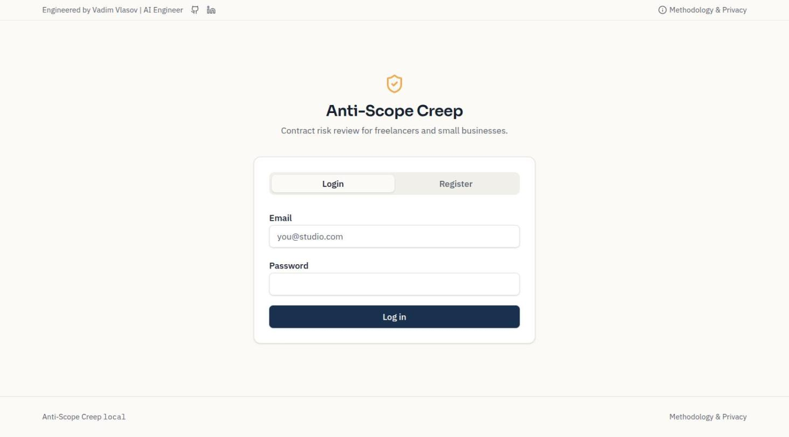
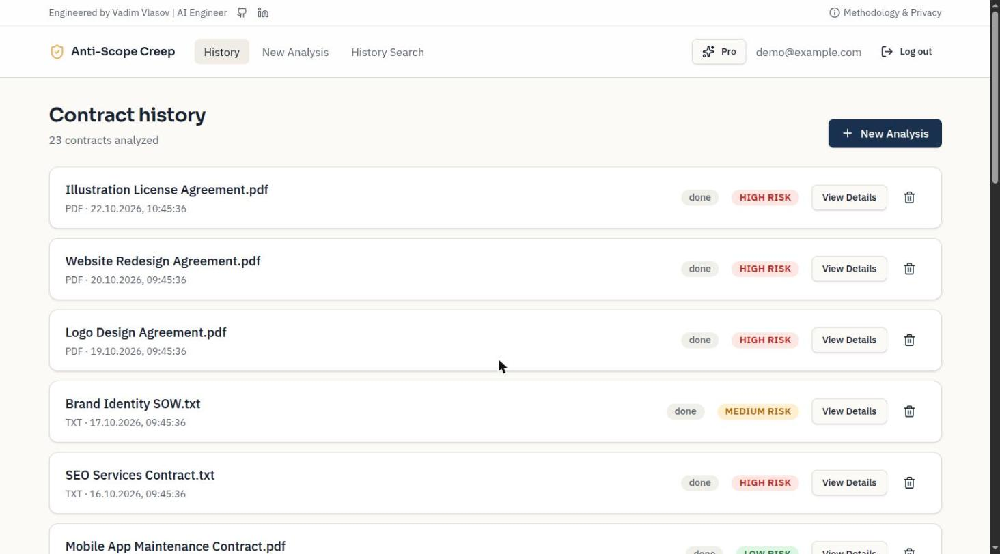
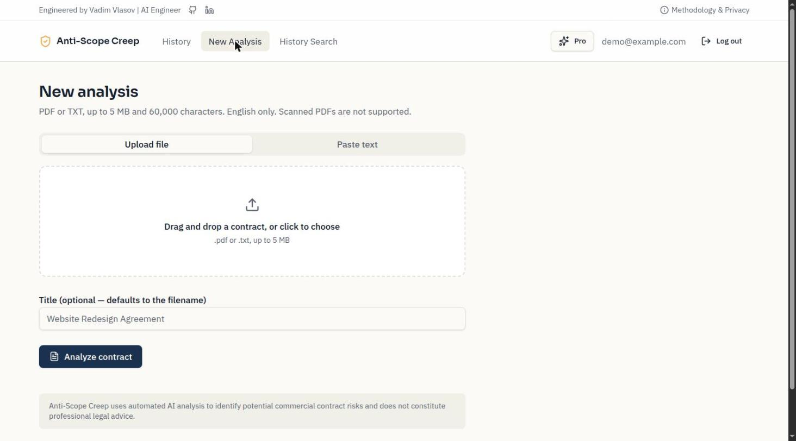
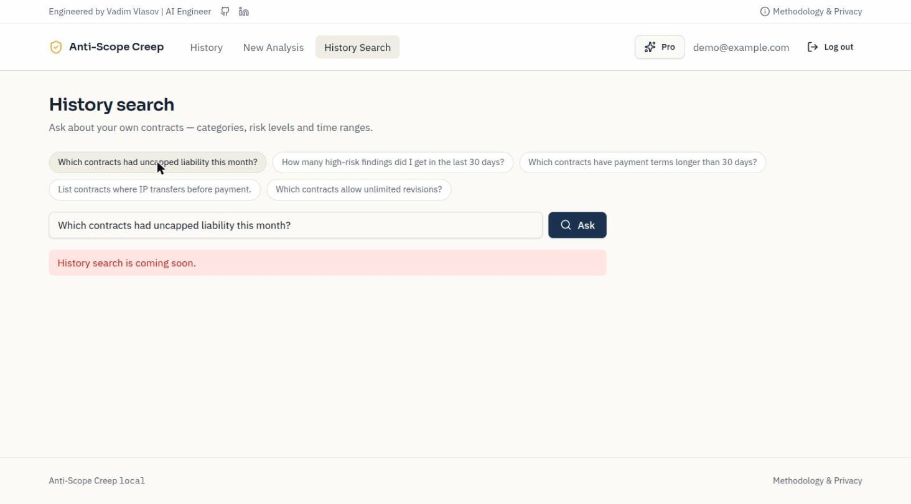
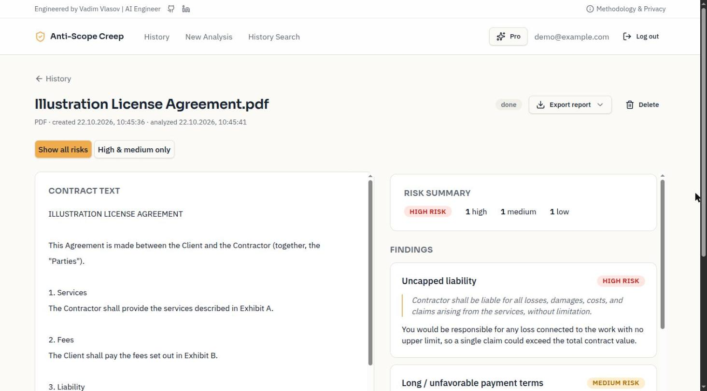

# Anti-Scope Creep

[](https://github.com/vadimvvlasov/anti-scope-creep/actions/workflows/ci.yml)

**Live:** https://anti-scope-creep.vadimvlasov.workers.dev (register any email; contracts are analyzed by the Groq LLM analyzer, see the
[AI data policy](docs/ai-data-policy.md))

## Problem

Freelancers and small businesses sign contracts without reading the fine print in
full. Risky clauses hide inside: one-sided termination with no compensation,
unrestricted IP transfer to the client, no cap on liability. Hiring a lawyer for
every contract isn't realistic, and there's rarely time to review one line by line.

## What it does

Anti-Scope Creep reads a contract, flags risky clauses by category (termination,
IP assignment, liability, etc.), and scores each one by risk level (low/medium/
high). It also keeps a searchable history: ask a question about past contracts in
plain English and get an answer without writing SQL.

## How it works for the user

1. Upload a contract (PDF/text) through the web app
2. Get back a list of flagged clauses: category, risk level, the exact quoted text,
   an explanation and a suggested change, plus a draft email to the client. A short
   contract takes seconds; a long one (about 55,000 characters) takes about three
   minutes on the free LLM tier
3. Export the result as a PDF or DOCX report
4. Ask questions about your contract history in natural language (e.g. "which
   contracts this month had uncapped liability?"), and the system translates the
   question into SQL and answers it. Planned: today this screen runs on mock data

## How it's built

Working today:

- An LLM (Groq, `openai/gpt-oss-120b`) reads the contract in chunks and returns
  findings as strict JSON: category, risk level, the quoted clause, an explanation
  and a suggested change, plus a draft email to the client
- Party and signatory names, emails, phone numbers, URLs, bank and tax IDs and
  street addresses are replaced with placeholders before the text leaves the
  backend, and restored in the answer
- Every quote is checked against the contract text; a finding whose quote is not
  there is dropped, so the user can click any finding and see the real clause
- Contracts, analyses and findings are stored in Postgres

Planned:

- History questions through a text-to-SQL agent behind guardrails: read-only
  access, a single SELECT, an enforced row limit
- A small classifier fine-tuned on the CUAD dataset to preselect risky clauses
  before the LLM call, which cuts tokens per contract

## Current status: Phase 4 (observability and an on-call agent)

The deployed app analyzes real contracts with the Groq LLM analyzer and reports on itself:
traces, metrics and logs reach Grafana Cloud, two alerts watch what a user would notice, and an
on-call agent answers an alert. CI/CD, dev and prod environments come from Phase 2.

What the app does today:

- React frontend (built in Lovable) with all five screens and a services layer
  (`frontend/src/services/api.ts`) that switches between the real API and an
  in-memory mock with one flag
- FastAPI backend that implements [`openapi.yaml`](openapi.yaml): email/password
  auth with 24-hour JWTs, contract upload (PDF, TXT, pasted text), background
  analysis, findings, client email draft, history with pagination
- PostgreSQL through SQLAlchemy, schema managed by Alembic migrations
- LLM analyzer on Groq (`openai/gpt-oss-120b`) in dev and prod: names and contact
  details are pseudonymized before the call, and a finding whose quote is not in the
  contract is dropped. Locally (`ANALYZER=stub`, the default) a deterministic stub
  returns the fixture findings from [`docs/spec.md`](docs/spec.md)
- Report export as PDF or DOCX: summary, a table of high and medium findings with
  proposed counter-clauses, and the client email
- History Search answers from mock data in mock mode; the real backend returns
  `501` (`History search is coming soon.`) until the text-to-SQL agent phase

Added in Phase 4:

- OpenTelemetry in the backend: traces, metrics and JSON logs, where traces and logs carry the same
  trace id. No contract text and no exception message leave the service (tests:
  `backend/tests/test_telemetry_signals.py` and `test_telemetry_exceptions.py`). The signals reach
  Grafana Cloud from dev and prod ([#74](https://github.com/vadimvvlasov/anti-scope-creep/issues/74))
- A dashboard and two alert rules on what a user notices (the failure rate of analyses, a 5xx), kept
  as files in [`ops/grafana/`](ops/grafana/README.md). An alert sends an email to the owner and a
  webhook to the agent in the same minute
- An on-call agent (Gemini in GitHub Actions, [`on-call.yml`](.github/workflows/on-call.yml)): it wakes
  on an alert, investigates the commit that was running from the telemetry and the repository, and
  opens a fix pull request or an issue. It never merges or deploys; a person reviews. It ran once end
  to end on a planned fault: [`ops/diagnosis/2026-10-21-oncall-drill.md`](ops/diagnosis/2026-10-21-oncall-drill.md)
- `make test-all`: unit and integration tests with one command (see [Tests](#tests))
- A public [tracker](https://github.com/vadimvvlasov/anti-scope-creep/issues) with acceptance criteria and a description of the
  [agent team](docs/ai-workflow.md#agent-team)

When the service breaks for a user, someone knows within a minute and a first diagnosis is waiting.

Added in Phase 3:

- The Groq analyzer behind `ANALYZER=groq`: chunking, strict structured output,
  a token bucket for the free-tier limits, retries with `retry-after`
- Pseudonymization before every LLM call and quote verification after it
- [AI data policy](docs/ai-data-policy.md) and a notice on the upload screen that
  the contract text goes to a third-party AI provider
- Findings prompt v6: per-category decision rules, chosen on a held-out CUAD set that
  was not used to tune it. An answer cut at the output token cap is never parsed: it is
  asked again once with a doubled budget, then the analysis fails. A generation that
  fails the provider's JSON validation (`400 json_validate_failed`) is also asked again
  once
- An offline eval with hand-labeled gold sets (CUAD contracts and synthetic
  freelance contracts): precision, recall and severity per category, see
  [`eval/README.md`](eval/README.md). It runs locally; CI never calls the LLM.
  Results in [`docs/eval.md`](docs/eval.md): with prompt v4 on Gemini 3.5 Flash-Lite,
  precision 0.94 and recall 1.0 on the freelance set and recall 0.8 on the held-out
  CUAD set. Groq `gpt-oss-120b`, which runs in dev and prod until the course
  submission, raises noticeably more false alarms on commercial contracts

Added in Phase 2:

- Docker images and `compose.yaml`: `make up` starts the whole system locally
- Playwright end-to-end tests, run in CI against the built stack
- CI on every pull request: backend and frontend tests, e2e, Semgrep, Docker build,
  and a check that `openapi.yaml` matches the routes the backend declares
- Automatic deploy of `main` to a dev environment and a manual, approved promotion
  of the same image to prod (see [Deploy](#deploy))

Not yet: the text-to-SQL agent ([#86](https://github.com/vadimvvlasov/anti-scope-creep/issues/86)) and the fine-tuned classifier.

Product rules live in [`docs/spec.md`](docs/spec.md), infrastructure and phases in
[`docs/architecture.md`](docs/architecture.md).

## AI-assisted development

The project is built spec-first, with AI tools doing most of the typing and a person
deciding, reviewing and verifying. The full process with real prompts is in
[`docs/ai-workflow.md`](docs/ai-workflow.md).

- **Spec first.** The product spec was worked out in a ChatGPT dialogue and saved as
  [`docs/spec.md`](docs/spec.md). It is the source of truth for every later step.
- **Frontend from the spec.** `scripts/build_lovable_prompt.py` turns the spec into a
  Lovable prompt; Lovable generated the React app with a mock services layer.
- **Contract from the frontend.** [`openapi.yaml`](openapi.yaml) was written from the
  frontend's API client, then the FastAPI backend was built against it. A test checks
  that the backend routes match the contract.
- **Backend and infrastructure with Claude Code.** [`AGENTS.md`](AGENTS.md) (read by
  Claude Code through `CLAUDE.md`) and [`frontend/AGENTS.md`](frontend/AGENTS.md) give
  the agent the commands, layout and rules: follow the spec and stop if it is unclear,
  no new dependencies without asking, no secrets in the repository, stay inside the task.
- **One step, one prompt, one pull request.** Each phase is planned as a list of steps.
  Each step gets one prompt, a feature branch and a PR; CI must be green before merge.
- **Human review and verification.** Every step has a checklist: new tests, the full
  suite, a manual check in the browser on dev, the smoke test after deploy. The LLM
  analyzer is checked against gold sets labeled by hand, not by the model.
- **Tasks and the agent team.** Tasks are public [issues](https://github.com/vadimvvlasov/anti-scope-creep/issues) with acceptance
  criteria, and a pull request closes each one (`Closes #<n>`). The team (the developer agent, a
  read-only API reviewer, the on-call responder, and the owner who reviews and merges) and who may
  touch what are in [`docs/ai-workflow.md`](docs/ai-workflow.md#agent-team).
- **Agent extension pack.** A reusable eval workflow (skill), a read-only API contract
  reviewer (subagent), a read-only MCP server over the API, a guard hook that blocks
  secrets and the developer's AWS and GitHub credentials, and the same pack as an
  installable Claude Code plugin: [`docs/agent-extension-pack.md`](docs/agent-extension-pack.md),
  permissions in [`docs/permissions.md`](docs/permissions.md).

  ```text
  /plugin install anti-scope-creep-agent-pack --marketplace vadimvvlasov/anti-scope-creep
  ```

## Where to find what

Course rubric items and where they live in this repository:

| Item | Where |
|---|---|
| Product spec and tracker | [`docs/spec.md`](docs/spec.md), [GitHub Issues](https://github.com/vadimvvlasov/anti-scope-creep/issues) |
| Agent instructions | [`AGENTS.md`](AGENTS.md), [`frontend/AGENTS.md`](frontend/AGENTS.md), `CLAUDE.md` |
| AI-assisted workflow | [AI-assisted development](#ai-assisted-development), [`docs/ai-workflow.md`](docs/ai-workflow.md) |
| Agent team | [`docs/ai-workflow.md`](docs/ai-workflow.md#agent-team), [`docs/permissions.md`](docs/permissions.md) |
| Agent extension pack | [`docs/agent-extension-pack.md`](docs/agent-extension-pack.md), [`docs/permissions.md`](docs/permissions.md), `agent-capabilities/`, `agent-hooks/`, `mcp-server/`, `plugins/` |
| Architecture | [`docs/architecture.md`](docs/architecture.md) |
| Frontend and its tests | `frontend/`, `frontend/src/**/__tests__/` |
| API contract | [`openapi.yaml`](openapi.yaml) |
| Backend and its tests | `backend/`, `backend/tests/` |
| Database and migrations | `backend/migrations/`, [Deploy](#deploy) for dev and prod |
| Containers | `backend/Dockerfile`, `frontend/Dockerfile`, [`compose.yaml`](compose.yaml) |
| Integration tests | `frontend/e2e/` (Playwright), [Tests](#tests) |
| Deployment | [Deploy](#deploy) |
| CI/CD | `.github/workflows/`, [`docs/deploy.md`](docs/deploy.md#workflows) |
| AI data policy | [`docs/ai-data-policy.md`](docs/ai-data-policy.md) |
| LLM eval | [`eval/README.md`](eval/README.md) (method), [`docs/eval.md`](docs/eval.md) (results) |
| Security audit | [`security/README.md`](security/README.md): scanner, dependency audit, model review, a decision per finding |
| Observability and alerts | [`backend/app/telemetry.py`](backend/app/telemetry.py), [`ops/grafana/`](ops/grafana/README.md): dashboard, alert rules, the webhook to the agent |
| On-call agent | [`.github/workflows/on-call.yml`](.github/workflows/on-call.yml), [`ops/diagnosis/2026-10-21-oncall-drill.md`](ops/diagnosis/2026-10-21-oncall-drill.md) |
| Operations | [`ops/README.md`](ops/README.md): runbook and diagnoses, including the on-call drill |
| Rubric coverage | [`docs/rubric.md`](docs/rubric.md): the 12 criteria, the evidence and what is open |
| Product analytics | [`docs/analytics.md`](docs/analytics.md): funnel events by acquisition channel, the Pro demand test |

## Screenshots

Screens 1–4 run against the real backend and Postgres; History Search runs on the
mock.

| | |
|---|---|
|  **Login / Register** |  **Contract History** |
|  **Upload / Analyze** |  **History Search** (mock) |

**Contract Details**: risk summary, findings with the quoted clause, and the client
email draft.



## Run locally

### With Docker (the full system, one command)

You need Docker with Compose.

```bash
make up      # Postgres, migrations, backend, frontend
```

Open http://localhost:3000 and log in as `demo@example.com` / `password123`
(demo accounts are described below). The API is on http://localhost:8000.
`make down` stops everything and keeps the database volume; `make logs` follows the logs.

`make up-observability` adds a local Grafana stack (`grafana/otel-lgtm`) and makes the backend export
traces, metrics and logs to it; Grafana is on http://localhost:3001 (admin / admin). The backend exports
only when `OTEL_EXPORTER_OTLP_ENDPOINT` is set, so a plain `make up`, the tests and CI send nothing.
Logs are JSON on stdout either way, with `trace_id` on traced requests.

### For development (hot reload)

Backend with `--reload` and the Vite dev server, against a local Postgres: see
[`backend/README.md`](backend/README.md#hot-reload-with-the-frontend).

## Deploy

| | Frontend | Backend | Database |
|---|---|---|---|
| **prod** | https://anti-scope-creep.vadimvlasov.workers.dev | https://anti-scope-creep-prod.w7ype86rjt6a6.eu-central-1.cs.amazonlightsail.com | Neon branch `production` |
| **dev** | https://anti-scope-creep-dev.vadimvlasov.workers.dev | Lightsail service `anti-scope-creep-dev`, created on deploy and deleted every night | Neon branch `dev` |

The frontend is static files on Cloudflare Workers. The backend is one container
on an AWS Lightsail container service (`eu-central-1`). The database is Neon
Postgres in the same region. The cloud databases start empty, without demo accounts.
Details and the reasoning behind these choices are in
[`docs/architecture.md`](docs/architecture.md), sections 2, 3 and 7.

Workflows, promoting an image, secrets and settings, deploying your own copy, the smoke test, versions and
cleanup: [`docs/deploy.md`](docs/deploy.md).

## Tests

All tests, unit and integration, with one command from a fresh clone:

```bash
make test-all
```

It installs the dependencies, starts a throwaway PostgreSQL (container `asc-pg-test`, port 5433,
database `asc_test`), runs the unit tests with it (`make test`, so the store, migration and
constraint tests run on PostgreSQL too), starts the full system in Docker, runs the end-to-end
tests against it (`make e2e`) and stops the stack and the test database again, also when a
test fails. On a fresh Linux machine install the browser's system libraries
once first: `cd frontend && npx playwright install --with-deps chromium`.

| Layer | Tests | Command |
|---|---|---|
| Unit | backend (pytest, in-memory SQLite; PostgreSQL variants with `make test-all`), frontend (Vitest) | `make test` |
| Integration | Playwright against the Docker stack: the real frontend, backend and Postgres | `make up`, then `make e2e` |

Step by step (install, unit tests, Playwright, the PostgreSQL tests): [`docs/testing.md`](docs/testing.md).

## Commands

Run from the repository root.

| Command | What it does |
|---|---|
| `make install` | Install backend (`uv sync`) and frontend (`npm i`) dependencies |
| `make up` | Build and start the full system in Docker: frontend on `http://localhost:3000`, backend on `http://localhost:8000` |
| `make down` | Stop the compose stack (the database volume is kept) |
| `make logs` | Follow the compose logs |
| `make e2e` | Run the Playwright end-to-end tests against the stack from `make up` |
| `make db` | Start the local Postgres 16 container `asc-pg` |
| `make migrate` | Apply Alembic migrations to `DATABASE_URL` |
| `make dev-backend` | Start the backend dev server on `http://localhost:8000` |
| `make dev-frontend` | Start the frontend dev server on `http://localhost:8080` |
| `make test` | Run backend and frontend tests |
| `make test-all` | Run the unit tests, start the Docker stack, run the end-to-end tests, stop the stack |
| `make lint` | Lint the frontend with ESLint |
| `python3 scripts/smoke.py <URL>` | Smoke test a deployed backend |
| `python3 -m unittest discover -s scripts` | Run the script tests |
| `python3 -m unittest discover -s agent-hooks` | Run the agent guard hook tests |
| `cd mcp-server && uv run python -m unittest` | Run the MCP server tests |
| `python3 scripts/sync_agent_pack.py` | Copy the agent pack sources into the plugin folder |

## Repository layout

| Path | Contents |
|---|---|
| `frontend/` | React app (Vite, TanStack Router), services layer and mock API |
| `backend/` | FastAPI app, SQLAlchemy store, Alembic migrations, tests |
| `openapi.yaml` | API contract between frontend and backend |
| `docs/spec.md` | Product specification: screens, API, data model, acceptance criteria |
| `docs/architecture.md` | Hosting, CI/CD, LLM provider, agent layer, phases |
| `docs/ai-data-policy.md` | What contract data goes to the LLM provider and what is kept |
| `agent-capabilities/`, `agent-hooks/`, `mcp-server/`, `plugins/`, `.claude/`, `.mcp.json` | Agent extension pack: skill, subagent, guard hook, MCP server, plugin, project settings |
| `docs/ai-workflow.md` | How the project was built with AI tools, with real prompts |
| `docs/screenshots/` | Screenshots used in this README |
| `eval/` | Gold sets and how the LLM analyzer is measured |
| `data/` | Synthetic contracts: pseudonymization fixtures and the base of the freelance eval set |
| `scripts/` | Smoke test and helper scripts (Python standard library only) |
| `.github/workflows/` | CI and deploy workflows |
