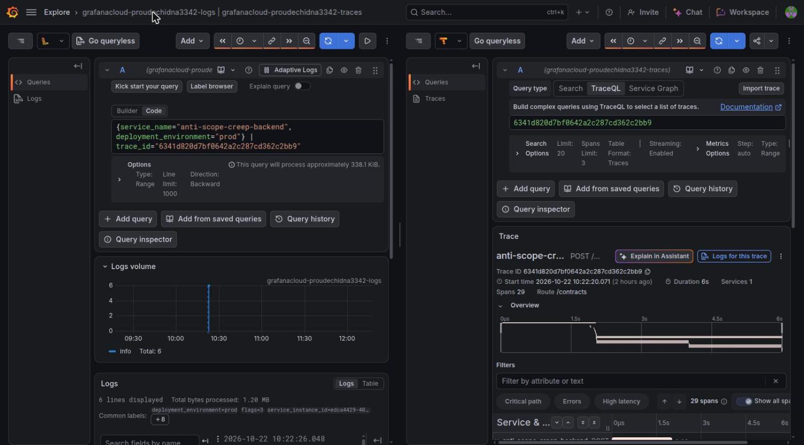

# Anti-Scope Creep

[](https://github.com/vadimvvlasov/anti-scope-creep/actions/workflows/ci.yml)

A web app that reads a freelance contract, flags risky clauses (termination, IP assignment, liability,
payment terms), scores each one and drafts an email to the client.

**Live:** https://anti-scope-creep.vadimvlasov.workers.dev (register with any email) ·
**Course rubric:** [the 12 criteria and where each one is shown](#rubric-map)

## Reviewer quick path

1. **Live:** register with any email, upload [`data/2.txt`](data/2.txt) (or paste text). The real model
   (Groq `gpt-oss-120b`) answers in seconds; a long contract takes a few minutes.
2. **Local:** `make up`, open http://localhost:3000, log in as `demo@example.com` / `password123`
   (23 demo contracts). Locally the analyzer is a **stub** that returns fixture findings, so the findings
   do not depend on the file you upload. `make down` stops it.
3. **Tests:** `make test-all` runs every test with one command (details in [Tests](#tests)).
4. **How it was built with AI agents:** [agent team](docs/ai-workflow.md#agent-team),
   [`AGENTS.md`](AGENTS.md), [public tracker](https://github.com/vadimvvlasov/anti-scope-creep/issues).

Demo limits: the live site uses the free tier of Groq (about 200,000 tokens per day for all visitors),
five analyses per user per 24 hours and one at a time. If an analysis fails with "Analysis failed", the
daily quota may be spent: try again later. [AI data policy](docs/ai-data-policy.md).

## Rubric map

| # | Criterion | Where to look | In one line |
|---|---|---|---|
| 1 | Problem Description | [Problem](#problem), [What it does](#what-it-does), [`spec.md`](docs/spec.md) | the problem, the behavior and screenshots are on this page |
| 2 | Product Specification | [`docs/spec.md`](docs/spec.md), [GitHub Issues](https://github.com/vadimvvlasov/anti-scope-creep/issues) | data model, status flow, severity matrix, error codes; tracker with acceptance criteria, closed by pull requests (`Closes #n`) |
| 3 | Agent Team Specification | [`docs/ai-workflow.md`](docs/ai-workflow.md#agent-team), [`docs/permissions.md`](docs/permissions.md) | ten roles, what each may and may not touch, a six-step flow |
| 4 | Context Management | [`AGENTS.md`](AGENTS.md), [`frontend/AGENTS.md`](frontend/AGENTS.md) | one entry file with commands, rules and links to the modular docs |
| 5 | Application | `frontend/`, `backend/`, [`openapi.yaml`](openapi.yaml) | React, FastAPI, Postgres; upload, background analysis, findings, report export |
| 6 | Testing | [Tests](#tests), [`docs/testing.md`](docs/testing.md) | backend 419, frontend 71, Playwright end-to-end 11; CI on every pull request |
| 7 | Containerization | [`compose.yaml`](compose.yaml), `backend/Dockerfile`, `frontend/Dockerfile` | `make up` starts Postgres, migrations, backend and frontend |
| 8 | Deployment | [Deploy](#deploy-and-cicd), [`docs/deploy.md`](docs/deploy.md) | public URL; Cloudflare Workers, AWS Lightsail, Neon; a smoke test after every deploy |
| 9 | CI/CD | [`.github/workflows/`](.github/workflows/), [Deploy](#deploy-and-cicd) | seven CI jobs on every pull request, auto deploy to dev, manual approved promote to prod, rollback in the [runbook](ops/runbook.md) |
| 10 | Observability | [Observability](#observability-alerts-on-call-agent), [`ops/grafana/`](ops/grafana/README.md) | traces, metrics and JSON logs with one trace id in Grafana Cloud (dev and prod); no contract text in telemetry (tested) |
| 11 | Alerting on User Impact | [`ops/grafana/alert-rules.yaml`](ops/grafana/alert-rules.yaml) | two rules on what a user notices; fired twice on a real fault; [alert email](docs/screenshots/07-alert-email-5xx.png) |
| 12 | On-Call Agent | [`on-call.yml`](.github/workflows/on-call.yml), [drill write-up](ops/diagnosis/2026-10-21-oncall-drill.md) | a real alert woke the agent and it opened a fix pull request ([#72](https://github.com/vadimvvlasov/anti-scope-creep/pull/72)); the fourth run of the drill, see below |

The evidence per criterion and what is still open: [`docs/rubric.md`](docs/rubric.md).

## Problem

Freelancers and small businesses sign contracts without reading the fine print. Risky clauses hide inside:
one-sided termination with no compensation, IP transferred before payment, no cap on liability. A lawyer for
every contract is not realistic, and there is rarely time to review one line by line.

## What it does

- Upload a contract (PDF or TXT, or pasted text; up to 5 MB and 60,000 characters, English) and get findings:
  category, risk level (low, medium, high), the exact quoted clause, an explanation, a suggested change and a
  draft email to the client
- Every quote is checked against the contract text; a finding whose quote is not there is dropped
- Names, emails, phone numbers, URLs, bank and tax IDs and addresses are replaced with placeholders before
  the text leaves the backend, and restored in the answer
- Contract Details shows the text beside the findings with highlights; export a PDF or DOCX report
- A short contract takes seconds; a long one (about 55,000 characters) about three minutes on the free tier
- **Planned, not built yet:** History Search answered by a text-to-SQL agent
  ([#86](https://github.com/vadimvvlasov/anti-scope-creep/issues/86); the screen exists and answers "coming
  soon"), and a classifier fine-tuned on CUAD

| Login / Register | Contract history | New analysis |
|---|---|---|
|  |  |  |

| Contract Details: text beside findings, export | History Search: "coming soon" until #86 |
|---|---|
|  |  |

## Run locally

```bash
make up      # Postgres, migrations, backend (http://localhost:8000), frontend (http://localhost:3000)
make down    # stop; the database volume is kept
```

- Needs Docker with Compose. Log in as `demo@example.com` / `password123`; the first start seeds 23 demo
  contracts in every status
- Hot reload, a real model locally (`ANALYZER=groq`, your own key) and the environment variables:
  [`backend/README.md`](backend/README.md), [`backend/.env.example`](backend/.env.example)
- A local Grafana for telemetry: `make up-observability` (http://localhost:3001)
- Every command (`make`, `uv`, the smoke test, the eval): [`AGENTS.md`](AGENTS.md)

## Tests

```bash
make test-all
```

- Installs the dependencies, starts a throwaway PostgreSQL, runs the unit tests (backend on SQLite and
  PostgreSQL, frontend with Vitest), starts the Docker stack, runs the Playwright end-to-end tests against
  it and stops everything, also when a test fails
- On 2026-10-22, from a fresh clone: backend 419 passed, frontend 71 passed, end-to-end 11 passed
- CI runs the same tests on every pull request, plus Semgrep, a Docker build and a check that
  `openapi.yaml` matches the routes
- Step by step, and on a fresh Linux machine: [`docs/testing.md`](docs/testing.md)

## Deploy and CI/CD

| | Frontend | Backend | Database |
|---|---|---|---|
| **prod** | https://anti-scope-creep.vadimvlasov.workers.dev | AWS Lightsail container service, `eu-central-1` | Neon branch `production` |
| **dev** | https://anti-scope-creep-dev.vadimvlasov.workers.dev | Lightsail service created on deploy, deleted every night | Neon branch `dev` |

- Every pull request: CI (backend, frontend, mcp-server, scripts, e2e, Docker, Semgrep); the `main` ruleset
  needs a pull request and green checks
- Merge to `main`: CI, then `deploy-dev` builds the image once, migrates, deploys and runs a smoke test
- Prod: **Promote to prod** is manual, takes an image that already ran in dev, and waits for a reviewer's
  approval; a smoke test checks `GET /version` against the promoted tag
- Rollback: promote the previous tag ([`ops/runbook.md`](ops/runbook.md))
- Workflows, secrets, deploying your own copy and cleanup: [`docs/deploy.md`](docs/deploy.md); the reasons
  for the choices: [`docs/architecture.md`](docs/architecture.md)

## Observability, alerts, on-call agent

- **Telemetry:** OpenTelemetry in the backend sends traces, metrics and JSON logs to Grafana Cloud from dev
  and prod; logs and traces share a `trace_id`. No contract text and no exception message leave the service
  (tests: `test_telemetry_signals.py`, `test_telemetry_exceptions.py`)
- **Dashboard and alerts:** a dashboard and two alert rules (failure rate of analyses, 5xx) as files in
  [`ops/grafana/`](ops/grafana/README.md); an alert emails the owner and calls a webhook
- **On-call agent:** Gemini in GitHub Actions wakes on an alert, investigates the commit that was running, and
  opens a fix pull request or an issue. It never merges or deploys; a person reviews
- **How the drill went** ([write-up](ops/diagnosis/2026-10-21-oncall-drill.md)): the first three runs found the
  cause but ended with no pull request or no verdict (a repository setting, then the turn budget, then a
  missing exception type in the context). After fixing those, the fourth run opened the fix pull request
  about three minutes after the alert email. It shows one kind of fault it can fix, not a success rate
  ([#82](https://github.com/vadimvvlasov/anti-scope-creep/issues/82))

| Errors on the dashboard | Traces with errors | A log line and a trace with the same trace id (prod) |
|---|---|---|
|  |  |  |

## How it was built with AI

- **Spec first:** [`docs/spec.md`](docs/spec.md) came from a ChatGPT dialogue and is the source of truth
- **Frontend from the spec:** a script turns the spec into a Lovable prompt; Lovable generated the React app
  with a mock services layer
- **Contract from the frontend:** [`openapi.yaml`](openapi.yaml) was written from the frontend's client, the
  FastAPI backend was built against it, and a test checks that the routes match
- **Backend and infrastructure with Claude Code**, steered by [`AGENTS.md`](AGENTS.md): follow the spec, stop
  if it is unclear, no new dependencies without asking, no secrets in the repository
- **One step, one prompt, one pull request:** CI must be green before merge; the LLM analyzer is checked
  against gold sets labeled by hand ([`docs/eval.md`](docs/eval.md))
- **Tasks and team:** public issues with acceptance criteria, closed by pull requests; the agent team and who
  may touch what: [`docs/ai-workflow.md`](docs/ai-workflow.md#agent-team),
  [`docs/permissions.md`](docs/permissions.md)
- **Extension pack:** an eval skill, a read-only API reviewer subagent, a read-only MCP server, a guard hook
  and a plugin: [`docs/agent-extension-pack.md`](docs/agent-extension-pack.md)

## More documents

| Document | What is in it |
|---|---|
| [`docs/architecture.md`](docs/architecture.md) | hosting, CI/CD, LLM provider, observability, the on-call agent, phases |
| [`docs/ai-data-policy.md`](docs/ai-data-policy.md) | what contract data goes to the LLM provider and what is kept |
| [`docs/eval.md`](docs/eval.md), [`eval/README.md`](eval/README.md) | how the analyzer is measured and the results |
| [`security/README.md`](security/README.md) | scanner, dependency audit, model review, a decision per finding |
| [`ops/README.md`](ops/README.md) | runbook and diagnoses |

Repository layout: `frontend/` (React, Vite), `backend/` (FastAPI, SQLAlchemy, Alembic, tests), `openapi.yaml`,
`docs/`, `ops/` (runbook, Grafana files, diagnoses), `eval/`, `data/` (synthetic contracts), `scripts/`,
`.github/workflows/`, and the agent files (`agent-capabilities/`, `agent-hooks/`, `mcp-server/`, `plugins/`,
`.claude/`).
