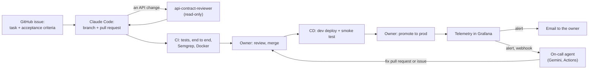

# AI-assisted workflow

How Anti-Scope Creep is built with AI tools: which tool does what, what context each one
gets, how work is split and handed to an agent, and how the result is reviewed and
verified. Short version in the [README](../README.md#ai-assisted-development).

## Tools and their roles

| Stage | Tool | Input | Output |
|---|---|---|---|
| Product spec | ChatGPT (dialogue) | problem, users, MVP scope, answers to its questions | [`docs/spec.md`](spec.md) |
| Frontend | Lovable | a prompt built from the spec by `scripts/build_lovable_prompt.py` | React app in `frontend/` with a mock services layer and tests |
| API contract | Claude Code | the frontend API client (`frontend/src/services/api.ts`) and the spec | [`openapi.yaml`](../openapi.yaml) |
| Backend, infrastructure, eval | Claude Code | `AGENTS.md`, the spec, `openapi.yaml`, one step prompt at a time | code, tests, workflows, docs; one PR per step |
| Decisions, labeling, review | a person | diffs, test results, the deployed app, eval errors | merge or rework; gold labels for the eval |

The spec was written in a separate ChatGPT dialogue on purpose: discussing the idea needs
no file access, and it would only fill the coding agent's context.

## Agent team

The table above says which tool produced what. This is the team as it works: each member's
responsibility, what it may touch, what it may not, and where the work goes next. The agents never
talk to each other; they hand work over as files and as events (a spec, a contract, a pull request,
a telemetry signal, an alert), so each one starts from the repository, not from a chat history.

| Member | Kind | Responsibility | May touch | May not |
|---|---|---|---|---|
| Product analyst | ChatGPT, a separate dialogue | turns the idea into the specification: users, MVP scope, data model, limits, severity matrix, error codes | [`docs/spec.md`](spec.md), committed by the owner | see or change the code |
| Frontend developer | Lovable | the React app and its mock services layer, from a prompt built from the spec | `frontend/` | the backend; calls to the API outside `src/services/api.ts` |
| Developer | Claude Code | the API contract, backend, infrastructure, CI/CD, eval, telemetry and docs, one step per branch and pull request | feature branches, pull requests, code, tests, workflows, docs | the spec or `openapi.yaml` without asking; a new dependency without asking; secrets; merging or deploying to prod on its own (only on the owner's explicit word) |
| API reviewer | subagent `api-contract-reviewer` (Claude Code) | reads an API change against the spec and `openapi.yaml` before the pull request is opened | read-only: `git diff`, the contract test | write files, change state |
| Eval operator | skill `eval-run` (Claude Code) | the repeatable procedure for a prompt or model decision: plan within the quota, run, score, compare, report | `eval/runs/`, `docs/eval.md` | tune a prompt on the held-out set |
| Eyes on the service | MCP server `anti-scope-creep` (any MCP client) | read-only tools over the API: `service_status`, `list_contracts`, `get_findings` | the public API of a deployment | change data |
| Guardrail | hook `agent-hooks/guard.py` (Claude Code) | blocks a tool call that reads secret files, prints the environment, calls the AWS CLI, merges (`gh pr merge`), reads secrets from GitHub, or commits secrets and contract files | every Bash and file tool call of Claude Code in a session opened in this repository | (it only blocks) |
| On-call responder | Gemini in GitHub Actions ([`on-call.yml`](../.github/workflows/on-call.yml)) | wakes on an alert, investigates the commit that was running, from telemetry and the repository; proposes a fix as a pull request or explains in an issue | read-only Grafana, the repository at the deployed commit, `oncall/*` branches, pull requests and issues (through the last workflow step) | push to `main`, deploy, read secrets; its model never sees a GitHub token |
| Automation | GitHub Actions CI/CD (not an AI) | the deterministic checks and the dev deploy | check results, the dev environment | deploy to prod without an approval |
| Owner | a person | decisions, labeling the gold sets, review, merge, promoting to prod, secrets and cloud accounts | everything | |

Exactly what each member may and may not do, and what enforces it, is in
[`permissions.md`](permissions.md); the pack of reusable parts (skill, subagent, MCP server, hook, plugin) is
in [`agent-extension-pack.md`](agent-extension-pack.md).

### How they work together



1. **A task starts as an issue** with acceptance criteria (see "Tracker" below).
2. **The developer agent takes one task** on a feature branch, reading `AGENTS.md`, the spec section and
   `openapi.yaml` first, and opens one pull request that closes the issue. If the spec is unclear or
   contradicts itself it stops and asks the owner instead of deciding.
3. **Checks before a person looks:** an API change goes to `api-contract-reviewer` first; CI runs the backend
   and frontend suites, the end-to-end tests, Semgrep and a Docker build.
4. **The owner reviews and decides on the merge.** Merging is reserved for the owner: in a Claude Code session
   opened in this repository the guard hook blocks `gh pr merge`, and the `main` ruleset asks for a pull request
   and green checks with no bypass. When a session runs elsewhere (outside the hook) and the owner says "merge",
   the agent runs the merge on that word; it never merges on its own.
5. **CD deploys to dev** and runs the smoke test; **promoting to prod is a separate, manual and approved run**
   of the owner.
6. **In operation the telemetry reaches the owner and the on-call agent in the same minute:** an alert sends an
   email and a webhook. The agent works on the commit named by the alert and answers with a fix pull request
   or an issue. That pull request goes through steps 3 and 4 like any other: CI runs only after the owner
   approves the run (GitHub holds the run of a bot) and the owner merges. This was run once on a planned
   fault, with its timeline: [`ops/diagnosis/2026-10-21-oncall-drill.md`](../ops/diagnosis/2026-10-21-oncall-drill.md).

Disagreements and doubts always go to the owner: an agent that is unsure says so (the on-call agent ends
with `needs_human` and an issue, never a silent fix) and nothing an agent produces reaches `main` or prod
without a person.

## Context files

- [`AGENTS.md`](../AGENTS.md): what the app is, the source of truth (the spec, then
  `openapi.yaml`), commands, branch and commit workflow, and rules. Claude Code reads it
  through [`CLAUDE.md`](../CLAUDE.md) (`@AGENTS.md`).
- [`frontend/AGENTS.md`](../frontend/AGENTS.md): frontend rules, for example that every
  backend call goes through `src/services/api.ts`.
- [`docs/spec.md`](spec.md): data model, validation limits, status flow, severity matrix,
  error codes, analysis rules. Prompts point to its sections by name instead of
  restating them.
- [`docs/architecture.md`](architecture.md): hosting, CI/CD, LLM provider and phases.

Rules in `AGENTS.md` that keep the agent inside its task:

- follow the spec exactly; if it is unclear or contradicts itself, stop and ask;
- do not edit the spec or change `openapi.yaml` silently;
- no new dependency without asking;
- never commit secrets; configuration only through environment variables;
- a feature branch for every change, small commits, the whole test suite green before a
  commit;
- stay inside the task: mention anything out of scope instead of fixing it.

## How work is split

The project goes in phases (see [`docs/architecture.md`](architecture.md), section 10).
Before a phase starts, it gets a plan: a list of steps, each with

1. why the step is needed;
2. one prompt for the agent;
3. a checklist of what to verify before the step counts as done.

One step is one prompt, one feature branch and one pull request. CI must be green before
merge. Deployment to prod is a separate, manual and approved workflow run.

## Tracker

The tasks are in the public [GitHub Issues](https://github.com/vadimvvlasov/anti-scope-creep/issues)
of this repository.

- **A task is an issue** made from the template [`task.md`](../.github/ISSUE_TEMPLATE/task.md): why, acceptance
  criteria as checkboxes, what is out of scope, and notes for the agent (what to read first).
- **A pull request closes it** with `Closes #<n>` in its description, so the issue, the diff and the result of
  the checks sit together. The developer agent comments on the issue when it starts and when the pull
  request is ready, and the owner ticks the criteria in review.
- **Agents open issues too.** The on-call agent opens an issue (`oncall`, `needs-human-review`) when it cannot
  settle an alert, and a pull request (`oncall`) when it can; those are in the same list.
- **Where the work was planned before.** The phase plans are in [`architecture.md`](architecture.md),
  section 10, and the step prompts and checklists were kept in the owner's own notes. The tracker was opened for
  the work of the last stretch and the backlog; earlier work is not rewritten into issues after the fact.
- Labels: `task`, `backlog` for what is not planned yet, `oncall` for what the on-call agent opened.

## Example: a step prompt

Phase 3, step 1, quote verification ([PR #20](https://github.com/vadimvvlasov/anti-scope-creep/pull/20)).
The prompt as it was given to Claude Code:

```text
Extend locate_quote in backend/app/quotes.py to the quote verification rule in
docs/spec.md ("Finding offsets", "LLM analyzer (Groq)"): find the quote in
source_text after normalizing whitespace (any run of whitespace equals one space,
leading/trailing ignored) and quote/dash characters (curly single and double quotes
to straight ones, en and em dashes to a hyphen). Return code-point offsets into the
ORIGINAL source_text, end exclusive, so the slice may differ from quoted_text only
in those characters. Build the normalized text with an index map back to the
original; do not use regex on the original with offsets guessed afterwards.
Keep the signature and the (None, None) result for a missing quote. An exact
match must give the same offsets as today, so the stub fixture is unaffected.
Tests: curly quotes, dashes, line breaks inside the quote, a quote at the very
start and end, an emoji before the quote (code points, not UTF-16), not found,
and an empty-after-normalization quote. No new dependencies. Do not change
docs/spec.md or openapi.yaml.
```

What makes it work: it names the spec sections instead of retelling them, says what
must not change (signature, stub offsets, spec, contract), forbids the shortcut that
would give wrong offsets, and lists the test cases up front.

The checklist for this step, verified before merge:

- the new quote tests and the whole backend suite pass, the runner and stub tests are
  unchanged;
- `source_text[start:end]` on a normalized quote returns the original piece of text,
  with its own quotes and line breaks;
- the frontend highlights the clause at those offsets correctly (a Vitest case with the
  offsets that `locate_quote` returned).

## Review and verification

Nothing generated is trusted because it compiles. Each layer has its own check:

| Layer | Check |
|---|---|
| Every change | a person reads the diff; backend (pytest) and frontend (Vitest) suites, ESLint, Semgrep and a Docker build in CI |
| API | a test compares the routes the backend declares with `openapi.yaml`, so the contract and the code cannot drift apart |
| Full system | Playwright end-to-end tests against the stack from `make up`, in CI |
| Deployment | `scripts/smoke.py` after every deploy: health, version, register, upload, analysis, delete |
| Privacy | contract text stays out of logs and errors, for example [`cccdeb7`](https://github.com/vadimvvlasov/anti-scope-creep/commit/cccdeb7) keeps it out of validation errors |
| LLM output | quotes are verified against the contract; quality is measured offline on gold sets |

The LLM analyzer is measured, not eyeballed. The eval ([`eval/README.md`](../eval/README.md))
runs it on two gold sets and reports precision, recall and severity accuracy per
category. Gold labels come from a person: scripts produce draft records, and a record
counts only after it is reviewed. A prompt change is accepted only if it does not get
worse on a held-out set that was never used to tune it. The eval runs locally; CI never
calls the LLM.

## What stays with a person

- product and provider decisions (for example, which LLM runs in prod and why);
- labeling the eval gold sets and deciding whether a prompt version is better;
- approving every merge and every prod deployment;
- secrets and cloud accounts.
