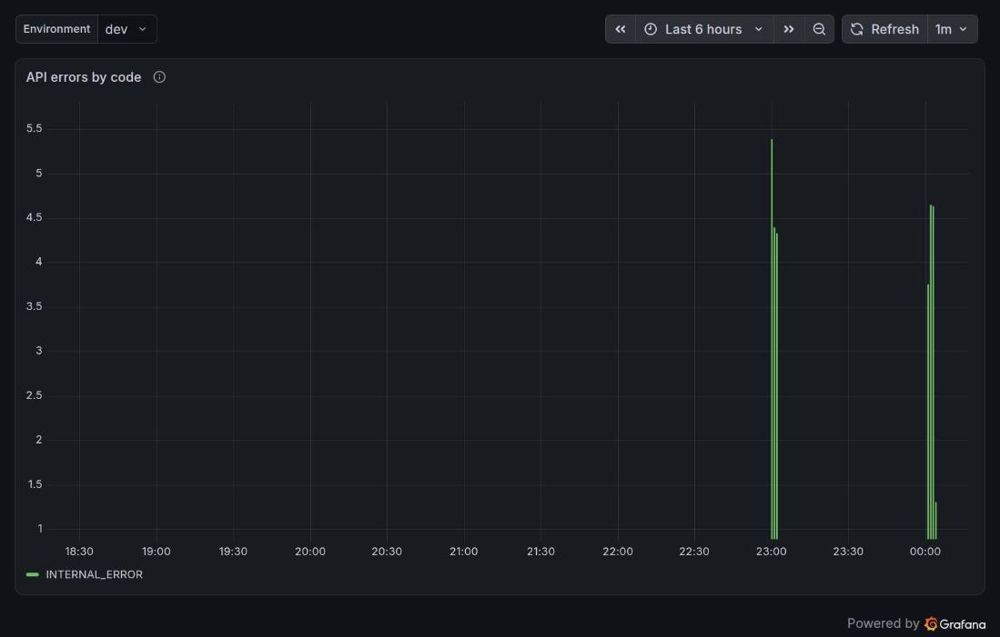
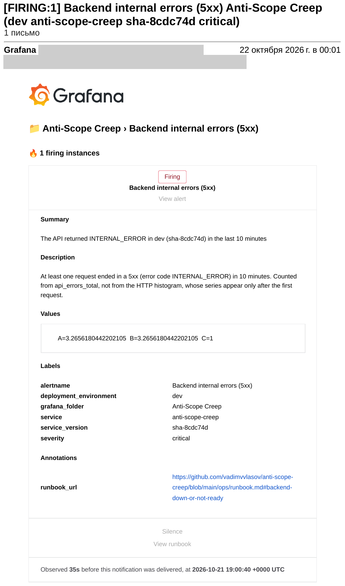
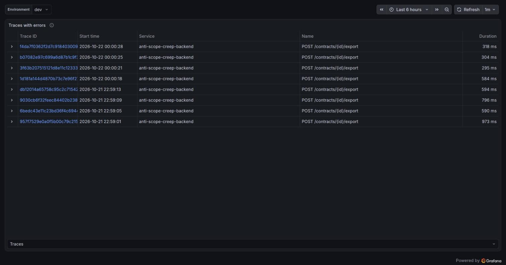

# 2026-10-21: the on-call drill, from a planned regression to a fix pull request by the agent

| | |
|---|---|
| Severity | none for users: a planned fault on dev only, prod was never promoted |
| Detected by | the Grafana alert rule "Backend internal errors (5xx)", twice (23:00 and 00:00 Yekaterinburg time) |
| Investigated by | the on-call agent (`.github/workflows/on-call.yml`, Gemini free tier); Claude Code read the runs, the traces and the logs of the agent and fixed the tooling around it |
| Fixed in | [#72](https://github.com/vadimvvlasov/anti-scope-creep/pull/72) (the product fix, written and opened by the agent), [#69](https://github.com/vadimvvlasov/anti-scope-creep/pull/69) and [#71](https://github.com/vadimvvlasov/anti-scope-creep/pull/71) (what the drill found in the agent and the telemetry), one repository setting |

This is an exercise, not a production incident. Its job was to show the whole chain once, end to
end: a fault reaches dev, an alert fires, a person gets an email, the agent wakes up on the
deployed commit, finds the cause, and opens a fix pull request that a person reviews. It did,
at the fourth run. The first three showed what was missing.

## Symptom

`POST /contracts/{id}/export` answers `500 INTERNAL_ERROR` for a contract whose title is in another
alphabet (here "Договор"). Titles in ASCII export fine, so no test and no end-to-end test noticed:
[#67](https://github.com/vadimvvlasov/anti-scope-creep/pull/67) changed `report_filename` to keep
letters of any alphabet (`\w`), and it was merged on purpose as a regression (the PR says so; the commit
subject looks like an ordinary improvement, because the agent reads the subjects of the latest commits).

## Timeline (Yekaterinburg time, UTC+5, 2026-10-21 unless stated)

| Time | Event |
|---|---|
| 22:52 | #67 merged, `Deploy dev` rolls `sha-443852b` out; prod is not promoted |
| 22:59:01 to 22:59:13 | four exports of the contract titled "Договор" on dev, all `500` (the four traces below) |
| 22:59:40 | the alert email is delivered, 35 s after the rule fired (`sha-443852b`, severity `critical`) |
| 23:00:17 | run 1 of the agent starts by itself (webhook, `repository_dispatch`) |
| 23:03 | run 1 ends red: the agent wrote a fix and pushed `oncall/39648800316`, but opening the pull request failed (`GitHub Actions is not permitted to create or approve pull requests`) |
| 23:11 | run 2, by hand on the same commit: 24 turns, ends with no verdict ([#68](https://github.com/vadimvvlasov/anti-scope-creep/issues/68)) |
| 23:33 | #69 merged: 40 turns and a warning when few turns are left |
| 23:34 | run 3, by hand: 40 turns, no verdict again ([#70](https://github.com/vadimvvlasov/anti-scope-creep/issues/70)) |
| 23:53 | #71 merged: exceptions in telemetry, the context of the agent, `finish` as the only tool on the last turns; `Deploy dev` rolls `sha-8cdc74d` out |
| 00:00:18 to 00:00:28 (22 Oct) | four exports again, all `500` |
| 00:00:40 | the second alert email (`sha-8cdc74d`) |
| 00:01:18 | run 4 starts by itself; 19 turns, verdict `fix`, pull request #72 opened by the agent |
| 00:11 | a person approves the held CI run of the pull request, reviews the diff and merges #72 |

## Investigation

### What the telemetry showed (read by hand, in Grafana)

The eight traces of the two bursts, all `POST /contracts/{id}/export`, 295 to 973 ms:

Opening one trace in Tempo (query `{ resource.service.name = "anti-scope-creep-backend" && status = error }`)
showed the server span with an `exception` event: `exception.type = UnicodeEncodeError`, a message about
the `latin-1` codec, and a traceback ending in `routers/contracts.py`. The status message of the span was
empty. That is the whole story: the file name goes into the `Content-Disposition` header, and Starlette
encodes headers as latin-1.

### Run 1 (by the alert): the agent finds it, the publish step fails

The agent picked the right commit from the label `service_version` (`sha-443852b`), found the cause, and
finished with `fix`: the branch `oncall/39648800316` has its fix and a regression test (commit `78bb0d5`),
and the `verify` step ran the whole backend suite on it, green. The publish step pushed the branch and then
failed on the pull request: the repository did not allow GitHub Actions to create pull requests (the manual
runs of the day before had always ended as issues, so this path had never run).

### Runs 2 and 3: no verdict

- Run 2 read the right files first, then spent turns 6 to 18 (13 of its 24) on searches, the spec and four
  frontend files, and wrote its fix on turn 24, with no turn left to run a test and call `finish`.
- Run 3 had 40 turns and the warnings of #69, wrote and rewrote files, and still went on reading on turns
  37 and 40, the two turns it was warned about.

Looking at what the agent was given, not at the model, explained both. Its context for the error span read
`POST /contracts/{id}/export ()`: the gatherer printed the span name and the (empty) status message, and
not the exception event that the trace had. With no exception type the agent had to search the repository
for the cause.

### Run 4: the same fault on the fixed tooling

The agent went to `routers/contracts.py` and `report.py` on turns 2 and 3, wrote the fix on turn 13 and its
test on turn 16, ran the export tests and the whole `tests/` directory, and finished with `fix` on turn 19.
The pull request has the alert, the changed files, the result of the check and the agent's own summary:

- `report_filename` goes back to `[^a-zA-Z0-9 ._-]` (what `docs/spec.md` says), and a test exports a
  contract titled "Договор 2026" and expects `200` and `_______ 2026 - Counter-proposal.pdf`.
- It names the commit that introduced the change and the line of the spec it breaks.

The pull request was open but blocked: GitHub holds a workflow started by a bot (`action_required`) until a
person approves it, and the CI run that the publish step starts on the branch by hand does not count as the
checks of the pull request. After the approval all seven checks passed and the pull request merged.

## Root cause

- The fault: `[^\w .-]` in `report_filename` lets non-ASCII letters into a header that is latin-1 only. The
  spec said ASCII, the tests used ASCII.
- Why the agent needed four runs, five separate causes:
  1. the repository setting that lets Actions create pull requests was off (run 1);
  2. the agent's context did not carry the exception type and the frames that the span had;
  3. the turn budget (24) was too small, and warnings in a message did not make the model stop;
  4. a pull request opened by a bot waits for a person to approve its CI run;
  5. found while reading the trace, not by the agent: the server span and the OpenTelemetry log handler
     exported `exception.message` and the full traceback. `docs/architecture.md` says no contract text goes to
     telemetry, and a message can hold some (a title or a clause that a handler puts into an error). Only the
     manual spans kept that rule; no test covered the unhandled-exception path.

## Fix

- The product fix is the agent's: #72.
- #69: 40 turns, and the model is told when 4 turns and 1 turn are left.
- #71: `ExceptionScrubber` (a span processor that runs before the exporter) and `ScrubbedLoggingHandler` export
  the exception type and the traceback frames (`file:line in function`), never the message, and cut a status
  `Type: message` to `Type`; the gatherer lists the type and the last 8 frames of an error span; on the last
  two turns `finish` is the only tool the model is offered. Tests: `backend/tests/test_telemetry_exceptions.py`
  and the scripts tests.
- The repository setting "Allow GitHub Actions to create and approve pull requests" is on. The `main` ruleset
  asks for a pull request and green checks, with no bypass, so the setting gives the workflow no way to merge.

## Prevention

- The agent's context should name the failure the way the telemetry does: the route, the exception type and the
  frames. Done in #71. When an agent wanders, look at what it was given before looking at the model.
- A budget the model can ignore is not a budget: the last turns restrict the tools, not only the prompt.
- Exceptions are third-party data until proven otherwise: type and frames go out, the message does not. A test
  pins it for spans and for logs.
- A person approves the CI run of the agent's pull request (GitHub does it by design), reviews the diff and merges.
  The runbook has the steps.
- Not done: the `runbook_url` of the rule "Backend internal errors (5xx)" points at "Backend down or not ready",
  while this case belongs to "The API answers 500"; the new runbook section has that name, and the rule in Grafana
  still has the old anchor.
- One finished run of four is not a measure of how reliable the agent is. The drill shows the chain and the
  kind of fault it can fix, not a success rate.

## Access during the investigation

- The agent: a read-only Grafana token (a Viewer service account) for metrics, logs and traces, the repository
  files, and a Gemini key in the `oncall` environment. Its model never sees a GitHub token; only the last step
  (`GITHUB_TOKEN`) pushes the branch and opens the pull request. It never pushed to `main` and had no deploy
  credentials. `pytest` of the checked-out tree ran without `GEMINI_*`, `ONCALL_*`, `GH_*` and `GITHUB_TOKEN`
  after #64.
- Claude Code: read-only queries in Grafana through the developer's browser session, `gh` for runs and pull
  requests, and the developer's approval before every merge, every change in Grafana and every setting of the
  repository. No AWS access: dev was reached over its public URL only.
