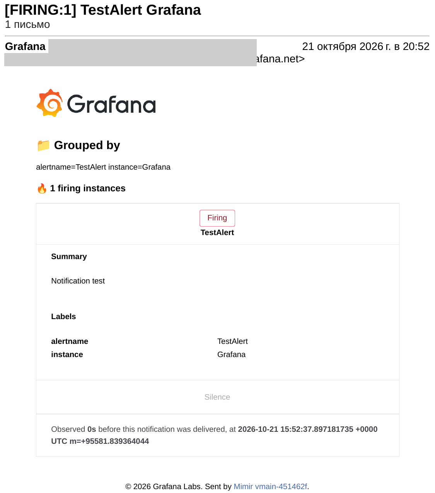

# Grafana dashboards and alerts

What the backend reports to Grafana Cloud (`docs/architecture.md`, section 6) and how
to read it. The files here are the source of truth: the dashboard in Grafana is an
import of [`dashboard.json`](dashboard.json), not hand-edited state.

| File | Contents |
|---|---|
| [`dashboard.json`](dashboard.json) | the "Anti-Scope Creep service health" dashboard (uid `asc-service-health`) |
| [`alert-rules.yaml`](alert-rules.yaml) | two alert rules on user impact, in the Grafana file provisioning format |
| [`oncall-webhook.yaml`](oncall-webhook.yaml) | the webhook contact point that wakes the on-call agent, and the notification policy that sends every alert to a person and to the agent |

## Import the dashboard

1. Grafana Cloud, **Dashboards**, **New**, **Import**.
2. Upload `dashboard.json` or paste its content, then **Load** and **Import**.
3. Pick the environment in the **Environment** selector (`dev`, later `prod`).

The data sources are referenced by the default UIDs of a Grafana Cloud stack:
`grafanacloud-prom` (metrics), `grafanacloud-logs` (Loki), `grafanacloud-traces` (Tempo).
The uid of the dashboard is fixed, so importing a changed file again replaces the
previous version. After a change, edit the JSON in git, not in the Grafana editor.

## What each panel answers

| Panel | Question | Source |
|---|---|---|
| Analyses done, failed or stale, Failure rate | did analyses finish in the selected time range? | `analyses_total{outcome}` |
| Analyses by outcome | when did runs finish or fail? | `analyses_total{outcome}` |
| Average analysis duration | is a run slow? | `analysis_duration_seconds_sum / _count` |
| LLM requests by status | does the model provider answer? | `llm_requests_total{status}` |
| Rate limited and truncated answers | are we hitting provider limits? | `llm_rate_limited_total`, `llm_output_truncated_total{retried="false"}` |
| API errors by code | what do users get back? | `api_errors_total{code}` |
| Findings dropped by reason | does verification remove findings? | `findings_dropped_total{reason}` |
| LLM tokens, last 24 h | how close is the daily Groq quota (200 000)? | `llm_tokens_total` |
| Warnings and errors | what did the backend log? | Loki, `severity_text` |
| Traces with errors | which requests failed, end to end? | Tempo, TraceQL `status = error` |

Notes:

- `increase()` extrapolates to the window edges, so a small count can show a fraction
  of a unit (five analyses can read 5.5). Read the stat panels as "about".
- The duration histogram uses the default OpenTelemetry bucket bounds (5, 10, 25, 50 s
  and so on), which are too coarse for a p95 in seconds; the panel shows the mean.
- The token gauge ignores the environment selector: the Groq quota is shared, and it
  counts every environment that exports telemetry. Prod does not export yet.
- `severity_text` and `trace_id` are Loki structured metadata, not stream labels:
  filter them in the pipeline (`| severity_text="ERROR"`), as the logs panel does.
- No contract content reaches these panels: telemetry carries ids, sizes, counts,
  model names, token counts and error codes only (`docs/architecture.md`, section 6).

## Checked

The queries of every panel were run against the dev stack on 2026-10-21 (Prometheus,
Loki and Tempo data source proxies, read only): all return `success`, the metric and
label names match `backend/app/telemetry.py`, and the TraceQL attribute
`resource.deployment.environment` exists. Dev had no warnings, errors or failed
analyses at that time, so those panels were checked for valid queries, not for data.

## Alert rules

Both rules alert on what a user notices, not on internal metrics. They run every minute
in the group `asc-service`, folder `Anti-Scope Creep`.

| Rule | Fires when | Pending | Severity |
|---|---|---|---|
| Analysis failure rate above 20 % | `failed / (done + failed + stale)` over 15 minutes is above 20 % **and** there were at least 3 runs in that window (one failed run out of one is not an incident); `superseded` runs are not counted | 2 minutes | critical |
| Backend internal errors (5xx) | `api_errors_total{code="INTERNAL_ERROR"}` grew in the last 10 minutes | none | critical |

Design choices:

- **Our own counters, not the HTTP histogram.** The instrumentation creates its
  `http_server_*` series on the first request, so `increase()` misses the first events.
  Our counters are created at 0 on startup (`init_series` in `backend/app/telemetry.py`).
- **No data is not an alert.** Dev is deleted every night, so its metrics disappear;
  `noDataState: OK` keeps that from firing. A query error keeps the last state
  (`execErrState: KeepLast`) instead of waking the on-call agent.
- **Every alert says where and which image.** The rules group by
  `deployment_environment` and `service_version` (`sha-<short sha>`), so those labels
  reach the notification. The on-call agent takes the commit to investigate from
  `service_version`. Each alert carries `summary`, `description` and a `runbook_url`
  into [`ops/runbook.md`](../runbook.md).
- **Labels for routing.** `service=anti-scope-creep` and `severity=critical` on both
  rules; notification policies route on them.

How it was checked: the YAML was loaded by a local Grafana (`grafana/otel-lgtm`) through
file provisioning, and synthetic counters pushed over OTLP (4 done and 4 failed analyses,
2 internal errors) made both rules fire with the expected labels and a rendered summary.
The queries also run on the dev stack of Grafana Cloud and return the labels above.

### Who gets an alert

Two contact points are planned (`docs/architecture.md`, section 6): a person gets an
email for every alert, and the on-call agent gets a webhook at the same time. The agent
never replaces the human notification, because it can misclassify.

| Part | State |
|---|---|
| Contact point `asc-human-email` (email) | created in Grafana Cloud on 2026-10-21; the address is set in Grafana only and is not in this repository; delivery checked the same day (below) |
| Root notification policy | receiver changed from the empty default to `asc-human-email` |
| Webhook to the on-call agent | defined in [`oncall-webhook.yaml`](oncall-webhook.yaml) (a `repository_dispatch` to `.github/workflows/on-call.yml`); created in Grafana Cloud after the workflow that understands `ref` is merged, see "Webhook to the on-call agent" below |

Delivery check, 2026-10-21: the **Test** button of the contact point sent Grafana's
predefined test alert, and the email arrived in the mailbox (timestamp 20:52 Yekaterinburg
time, 15:52 UTC; the sender and reply-to addresses are blacked out because they contain
the stack name).
This proves the path from Grafana to a person, not the two rules themselves; those
fire only on real failures and are covered by the rehearsal in `ops/diagnosis/`
once it exists.



### Webhook to the on-call agent

[`oncall-webhook.yaml`](oncall-webhook.yaml) holds the contact point `asc-oncall-webhook` and
the notification policy. Every alert with `service=anti-scope-creep` goes to a person by email
(first route, `continue`) and to the agent (second route); anything else goes to the email
contact point by default. The webhook route groups per alert, environment and image
(`alertname`, `deployment_environment`, `service_version`), waits 30 seconds, and repeats
at most once a day: each wake-up is a model run and a pull request or an issue.

Grafana posts to `POST /repos/vadimvvlasov/anti-scope-creep/dispatches`. GitHub wants
`event_type` and `client_payload`, so the contact point uses a custom payload template. A
real payload of the rule "Backend internal errors (5xx)" looked like this (test data):

```json
{
  "event_type": "grafana-alert",
  "client_payload": {
    "alert_name": "Backend internal errors (5xx)",
    "status": "firing",
    "environment": "test",
    "ref": "sha-test123",
    "summary": "The API returned INTERNAL_ERROR in test (sha-test123) in the last 10 minutes",
    "starts_at": "2026-10-21T17:03:40Z",
    "labels": {"alertname": "Backend internal errors (5xx)", "deployment_environment": "test",
               "service": "anti-scope-creep", "service_version": "sha-test123", "severity": "critical"}
  }
}
```

`ref` is the `service_version` label, the tag of the image that was running when the alert
fired. `.github/workflows/on-call.yml` strips `sha-`, accepts only a commit that is already in
`main` and investigates that commit (`docs/architecture.md`, section 5).

The token is not in the file. It is a fine-grained personal access token for this repository
only, with the repository permission Contents: read and write (the only permission
`repository_dispatch` accepts), valid for 30 days, entered once in the Grafana UI (contact
point, Authorization header, credentials). The `main` ruleset has no bypass, so the token
cannot change `main`. Rotate it before it expires.

How it was checked: a local Grafana loaded both files, the synthetic counters from the check
above fired the rule, one alert reached both receivers (two alert groups, one per receiver),
and a local HTTP server recorded the webhook request: the path, a `Bearer` header, the JSON
above. Not checked here: the call to the real GitHub API and the workflow run it starts
(see the rehearsal in `ops/diagnosis/`).

### Apply the rules

The rules were created in Grafana Cloud through the provisioning API, with a user
session and `X-Disable-Provenance: true` so they stay editable in the UI:

1. `POST /api/folders` with uid `asc-alerts` and title `Anti-Scope Creep`.
2. `PUT /api/v1/provisioning/folder/asc-alerts/rule-groups/asc-service` with the group
   of `alert-rules.yaml` as JSON (`title`, `interval: 60`, and each rule with
   `folderUID`, `ruleGroup`, `orgID: 1`, and `queryType: ""` on the query steps).

A self-hosted Grafana can read `alert-rules.yaml` directly from its
`provisioning/alerting/` folder, which is how the local check above was done (replace the
datasource uid `grafanacloud-prom` with the uid of your Prometheus datasource).

See also the [runbook](../runbook.md) for what to do when a panel or an alert shows a
problem.
